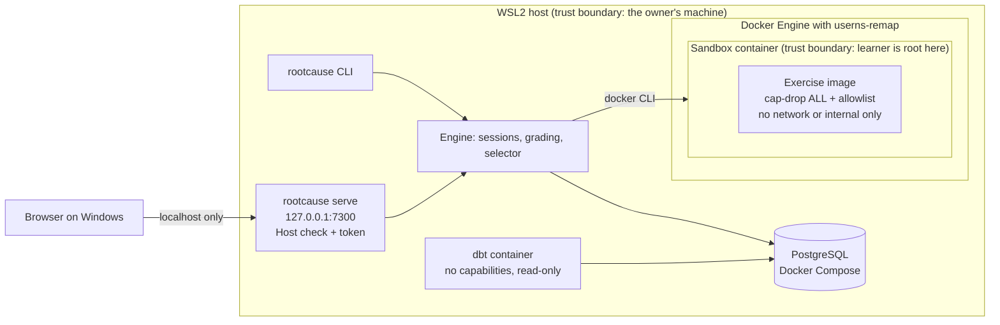
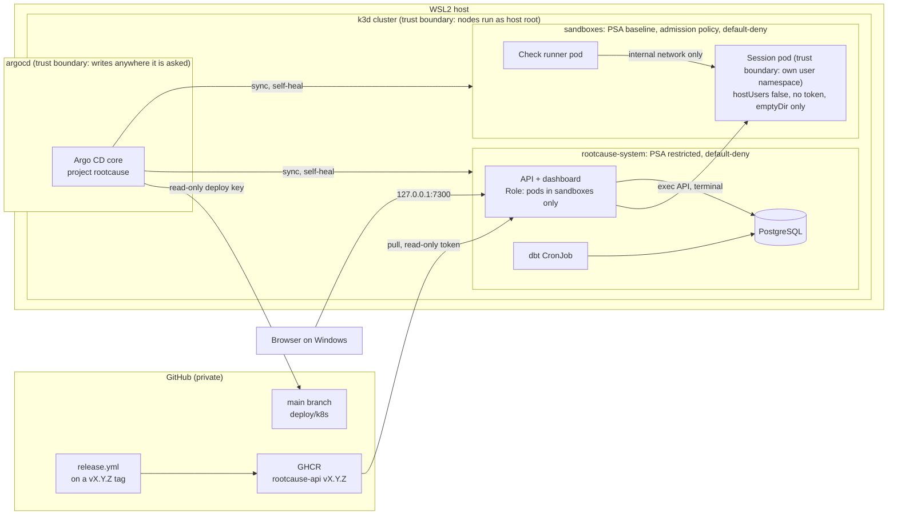

# RootCause

Hands-on IT troubleshooting practice. Each exercise is a broken Linux machine with a planted fault, delivered as a helpdesk ticket. The learner finds and fixes the fault in a terminal, an automated check grades the result, and the next exercise adapts to the learner's weak spots.

**Status:** in development.

See [`docs/SPEC.md`](docs/SPEC.md) for the full specification.

## How it works

RootCause has two ways to run sessions. Both use the same engine, database and dashboard; only the runtime that creates sandboxes changes (`RC_RUNTIME`). The boxes marked as trust boundaries are where one side must not be able to reach into the other. The decisions behind each part are in [`docs/adr`](docs/adr/README.md).

### v1: local, with Docker



### v2: the local k3d cluster, deployed by Argo CD



- A sandbox can reach neither the internet nor `rootcause-system`, and only a check runner may connect to it.
- The API's service account may only create, read, exec into and delete pods in `sandboxes`. The admission policy refuses any sandbox pod that is not locked down, whoever creates it.
- Everything the cluster publishes listens on the host's 127.0.0.1 only.

## Local setup

RootCause runs in WSL2 or Linux with Docker Engine and Go. Each exercise runs in a container where you are root, so root in the container must not be root on your machine. Docker must use user namespace remapping or rootless mode. The CLI refuses to start sessions otherwise.

1. Create `/etc/docker/daemon.json` with `{"userns-remap": "default"}`, then run `sudo systemctl restart docker`. Docker then uses a separate storage area, so images you pulled before are pulled again.
2. Check that `docker info --format '{{json .SecurityOptions}}'` shows `name=userns`.
3. Copy `deploy/compose/.env.example` to `deploy/compose/.env` and set a password.
4. Run `go run ./cmd/rootcause init`, then `go run ./cmd/rootcause list`.
5. Run `go run ./cmd/rootcause next` to start the recommended exercise. Statistics are built with dbt in a container (the first run pulls the image).

### Dashboard

The dashboard is a React app in `web/`, built into the binary. Building it needs Node 24 (see `web/.nvmrc`), and only at build time.

1. Run `scripts/build-web.sh`. It runs `npm ci` from the committed lockfile, a type check, and `vite build` into `web/dist`.
2. Build the binary with the dashboard embedded: `go build -tags webdist -o rootcause ./cmd/rootcause`.
3. Run `./rootcause serve` and open http://localhost:7300 in a browser on Windows. Stop it with Ctrl-C.

The server listens on 127.0.0.1 only. WSL2 forwards `localhost` from Windows to it, so no `.wslconfig` change is needed. Work in the sandbox with `./rootcause shell` in a WSL terminal next to the browser. The dashboard follows the CLI: hints, checks and results from either side show up in both. A binary built without `-tags webdist` still runs `serve`, but shows a page that says how to build the dashboard.

Exercises that boot systemd (such as svc-02) need a host with cgroup v2. WSL2 uses cgroup v2 by default. Check with `docker info --format '{{.CgroupVersion}}'`, which must print `2`.

### Kubernetes (v2)

The same sessions can run in a local k3d cluster (spec section 8.2): the API and dashboard, Postgres and dbt in the namespace `rootcause-system`, one pod per session in `sandboxes`, and the terminal in the browser. Argo CD in `argocd` deploys the cluster from `main` (see GitOps below).

1. Run `scripts/install-k8s-tools.sh`. It puts pinned, checksum-verified `k3d` and `kubectl` in `~/.local/bin`, without sudo.
2. Run `scripts/k8s-up.sh --dev` to try the working tree: it creates the cluster (1 server, 2 agents), builds the API image and the exercise images and imports them, generates the database password into git-ignored `deploy/k8s/.env`, and applies `deploy/k8s-dev`. Re-run it after a change. If Argo CD is installed, `--dev` turns its automated sync off first.
3. Open http://localhost:7300. Start an exercise and work in the terminal on the exercise page.
4. Run `scripts/k8s-prove.sh` to check the isolation: the API's permissions, the network policies, one full session through the dashboard, that every published port is bound to 127.0.0.1, and the sandbox admission policy (each forbidden pod change refused, as the API and as Argo CD). That session plays on a separate database, `rootcause_cluster_test`, through a second API pod, and leaves the real one untouched.
5. Run `scripts/k8s-down.sh` to stop the cluster and free memory; its data stays. `scripts/k8s-dbt.sh` rebuilds the statistics at once instead of waiting for the 10-minute CronJob. `scripts/k8s-memory.sh` prints the memory each node and container uses.

`RC_RUNTIME=kubernetes` points the CLI at the cluster, for example `RC_RUNTIME=kubernetes scripts/validate-exercise.sh perm-01-shared-folder 1`. svc-02 boots systemd, which does not run in a pod, so it is refused there (spec section 13.3).

### GitOps (v2)

Without `--dev`, `scripts/k8s-up.sh` installs Argo CD core (pinned, checksum-verified) and the Application in `deploy/argocd`, which syncs `deploy/k8s` from `main` with automated sync, prune and self-heal. The cluster then runs the API image pinned by digest in `deploy/k8s/kustomization.yaml`, pulled from the private package `ghcr.io/dizamu/rootcause-api`. Exercise images are still built and imported by `k8s-up.sh`; sandbox pods never pull.

A change reaches the cluster like this, with no kubectl by hand:

1. Merge the change to `main`.
2. Tag it and push the tag. `git tag -s` signs it with the same SSH key as the commits; check before you push:
   ```bash
   git checkout main && git pull --ff-only
   git tag -s v0.8.0 -m v0.8.0
   git tag -v v0.8.0
   git push origin v0.8.0
   ```
   `release.yml` checks that the tag is `vX.Y.Z` on `main` and new, validates every exercise, builds the API image and pushes it under that tag only. Its job summary shows the digest.
3. In a pull request, set that digest in `deploy/k8s/kustomization.yaml` (`images:`, digest only). `ci-release-image` checks that it is a pushed release. When it is merged, Argo CD rolls it out.

Check the result with `scripts/k8s-gitops-prove.sh` (set `RC_RELEASE_DIGEST` to the digest from the job summary to compare it too): the Application is Synced and Healthy at `main` with self-heal on, the API runs the pinned digest, a change made by hand is reverted, and the project refuses other namespaces and repositories. It fails while a `--dev` run has turned automated sync off.

Two credentials stay outside the repo, in `~/.config/rootcause` (chmod 600). `k8s-up.sh` turns them into Secrets and never prints them:

- `argocd-deploy-key`: the private half of a read-only deploy key for this repository. Make it with `ssh-keygen -t ed25519 -N '' -C rootcause-argocd -f ~/.config/rootcause/argocd-deploy-key`, then add the `.pub` file under Settings, Deploy keys, with write access off. The key has no passphrase, so it is unencrypted on disk. That is acceptable for a read-only key to one private repository, and the Secret in the cluster holds it in plain text anyway.
- `ghcr-token`: a personal access token (classic) with only the `read:packages` scope and a 90-day expiry, made under Settings, Developer settings, Personal access tokens, Tokens (classic). GitHub Packages accepts only classic tokens. A classic `read:packages` token can read every package your account can see, not just this one. When it expires, make a new one, save it to the same file and run `k8s-up.sh` again.

## Tests

Unit tests need nothing: `go test ./...`. Integration tests need a database whose name ends in `_test`, and Docker with userns-remap:

```bash
docker exec rootcause-postgres-1 createdb -U rootcause rootcause_test
export RC_TEST_DATABASE_URL="postgres://rootcause:<password>@127.0.0.1:5432/rootcause_test?sslmode=disable"
go test -count=1 ./...
```

- A test skips only when `RC_TEST_DATABASE_URL` is unset, or when Docker is missing. If the variable is set but the database is unreachable or not a `_test` database, the test fails.
- `RC_REQUIRE_DOCKER=1` makes a missing Docker fail the tests too. CI sets it.
- Tests that run dbt create and drop their own database (for example `rootcause_selector_test`), because a dbt build reads every row in its database.
- `RC_DBT_STRESS=1 go test -run TestBuildStress ./internal/dbt/` kills dbt builds at random points and checks that the next build succeeds. `RC_DBT_STRESS_ROUNDS` sets the rounds (default 10).
- A failed dbt build saves its full `dbt.log` under `~/.cache/rootcause/dbt-logs/` and prints the path. The newest 20 are kept.
- `TestClusterSession` plays a session against the deployed cluster and runs only with `RC_CLUSTER_URL` set; `scripts/k8s-prove.sh` sets it.
- `TestSandboxAdmission` checks the sandbox admission policy against the pods the runtime builds, with server-side dry runs as the API and as Argo CD, and runs only with `RC_CLUSTER_ADMISSION` set; `scripts/k8s-prove.sh` sets it too.

## CI

GitHub Actions runs five workflows (spec section 14). Every action is pinned by commit SHA, and every job gets read-only access to the repository and nothing else, except `packages: read` on `ci-release-image` and `release-check`, and `packages: write` on `release-push`.

| Workflow | Check name | Does |
|---|---|---|
| `ci.yml` | `ci-checks`, `ci-test`, `ci-release-image` | gofmt, go vet, golangci-lint, shellcheck, i18n parity, the dashboard build, and every Go test with Postgres and Docker. Fails if any test is skipped. Also fails if a script puts a credential on a command line, or if the rendered sandbox admission policy loses a rule, its Fail policy or its Deny-only binding. `ci-release-image` checks that the digest in `deploy/k8s/kustomization.yaml` is a pushed `vX.Y.Z` release, or the zero placeholder |
| `exercises.yml` | `exercises` | Validates the changed exercises with seeds 1, 2 and 3. All of them on manual runs, and when `release.yml` calls it |
| `dbt.yml` | `dbt` | dbt build against a Postgres service container, when the dbt project or its inputs changed |
| `commit-policy.yml` | `commit-policy` | Rejects Co-authored-by trailers, tool attribution lines, author emails other than the owner's, and commits GitHub does not show as Verified |
| `release.yml` | `release-check`, `exercises`, `release-push` | On a tag `v*`: the tag must be `vX.Y.Z` on `main` and not pushed before; every exercise is validated; then the API image is pushed to GHCR under that tag. It never commits |

Run the same commit check locally with `scripts/check-commit-policy.sh origin/main HEAD`.

### When the repo goes public

On the free plan, branch protection does not apply to private repositories, so a red check does not block the merge button. The rule until then: never merge a PR with a red check. When the repo goes public, add a ruleset under Settings, Rules, Rulesets:

- Target: the default branch (`main`). Enforcement: Active. No bypass list.
- Restrict deletions, and block force pushes.
- Require a pull request before merging, with merge commits only (squash and rebase drop the SSH signatures).
- Require signed commits.
- Require status checks to pass, with the branch up to date: `ci-checks`, `ci-test`, `ci-release-image`, `exercises`, `dbt`, `commit-policy`. Every workflow starts on every PR and decides inside the job what to run, so none of these checks stays pending.

Known gap to close when the ruleset goes on: the workflows, `scripts/check-commit-policy.sh` and `.githooks/commit-msg` run from the PR's own commits, so a PR could weaken the checks that judge it. Before the repo goes public, make `commit-policy.yml` check out the base branch's copy of the script and hook, and require review of changes under `.github/`, `scripts/` and `.githooks/`.

## License

PolyForm Noncommercial 1.0.0. See [`LICENSE`](LICENSE).
