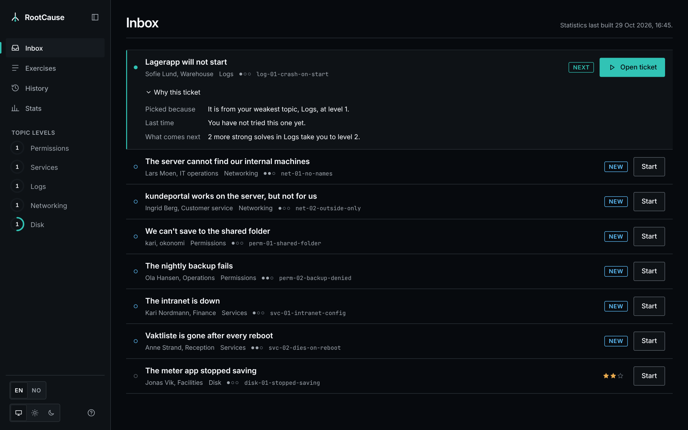
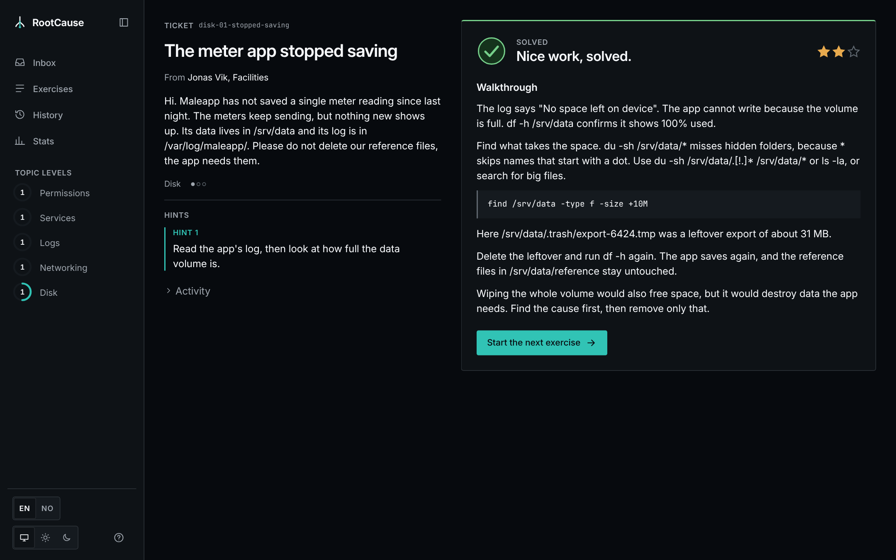
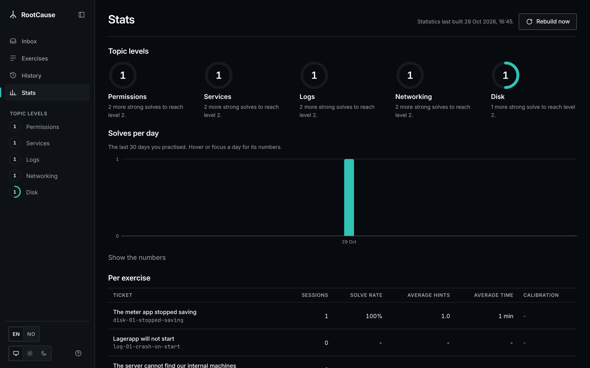
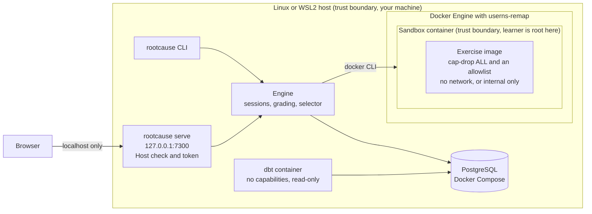
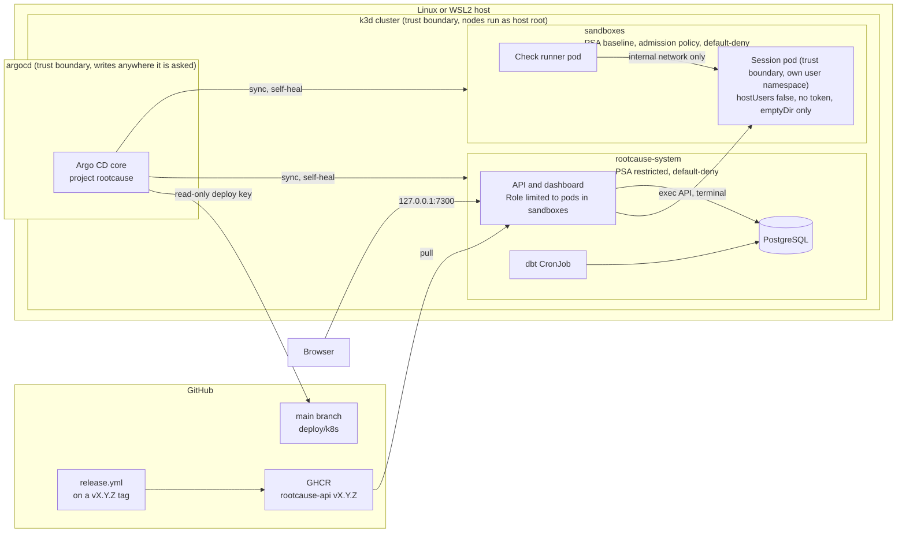

# RootCause

Practise fixing real, broken Linux servers.

RootCause hands you a helpdesk ticket and a Linux machine with a planted fault. You find the cause and fix it in a terminal, an automated check grades the result, and the next ticket adapts to your weak spots. Everything runs locally, in English or Norwegian.

<!-- Demo video. Drag rootcause-demo.mp4 into this file in GitHub's web editor and it replaces this comment with the video. -->



## What it does

- **Real machines.** Every exercise is a disposable container, or a Kubernetes pod, with a real fault in permissions, services, logs, networking or disk.
- **Graded by the end state.** A check tests what you left behind, never the commands you typed. Any valid fix passes, and the usual shortcuts fail.
- **Hints with a cost.** Three hint tiers go from where to look to nearly the answer. A solve earns 3, 2 or 1 stars depending on the hints used. Time is recorded but never scored.
- **Adaptive.** Each topic has a level from 1 to 3. RootCause picks your weakest topic next and brings back exercises you struggled with, as a new variant.
- **Randomized variants.** File names, ports, users and senders change from a seed, so a repeat is never the exact same machine.
- **Statistics.** A dbt pipeline turns every session into progress, a review queue and difficulty calibration.
- **A CLI and a dashboard.** Use either or both, and they follow each other.



## Quick start

RootCause runs on Linux (tested on Ubuntu 24.04) and on Windows 11 with WSL2. You need Docker Engine with the Compose plugin, Go 1.27 and Node 24. Node is only needed to build the dashboard.

Each exercise runs in a container where you are root, so root in the container must not be root on your machine. Docker has to use user namespace remapping or rootless mode, and RootCause refuses to start a session otherwise.

1. Turn on user namespace remapping. Create `/etc/docker/daemon.json` with `{"userns-remap": "default"}` and run `sudo systemctl restart docker`. Docker then uses a separate storage area, so images are pulled again. Check that `docker info --format '{{json .SecurityOptions}}'` shows `name=userns`.
2. Clone the repository and set a database password.
   ```bash
   git clone https://github.com/DIZAMU/RootCause.git && cd RootCause
   cp deploy/compose/.env.example deploy/compose/.env   # then set POSTGRES_PASSWORD
   ```
3. Build the dashboard and the binary.
   ```bash
   scripts/build-web.sh
   go build -tags webdist -o rootcause ./cmd/rootcause
   ```
4. Start the database and create your profile with `./rootcause init`.
5. Run `./rootcause serve` and open http://localhost:7300. Pick a ticket, then run `./rootcause shell` in a terminal next to the browser to work on the machine. Stop the server with Ctrl-C.

The first start of each exercise builds its image, which takes a minute. The first statistics build pulls the dbt image.

You can also play from the CLI alone. `./rootcause next` starts the recommended ticket, and `./rootcause` on its own lists every command.

The exercise that boots systemd (svc-02) needs cgroup v2, which is the default on current distributions and on WSL2. `docker info --format '{{.CgroupVersion}}'` must print `2`.

### Using the dashboard

- The inbox shows the recommended ticket first, with why it was picked.
- Ctrl+K opens the command palette, Ctrl+Enter runs the check (in the terminal too), and `?` shows every shortcut.
- A browser's first visit opens a short guided intro, and the "?" button shows it again.
- "Reset all data" in the help dialog, or `./rootcause reset --all`, deletes your history and starts you fresh. It cannot be undone.



## Kubernetes mode

The same sessions can run in a local k3d cluster. The API, dashboard, Postgres and dbt run in one namespace, each session gets a locked-down pod in another, and the terminal is right in the browser.

1. Run `scripts/install-k8s-tools.sh`. It puts pinned, checksum-verified `k3d` and `kubectl` in `~/.local/bin`, without sudo.
2. Run `scripts/k8s-up.sh --dev`. It creates the cluster (1 server, 2 agents), builds every image from your checkout, imports them and deploys RootCause. It needs no credentials.
3. Open http://localhost:7300 and work in the terminal on the session page.
4. Run `scripts/k8s-prove.sh` to check the isolation. It tests the API's permissions, the network policies, the admission policy, one full session, and that every published port is bound to 127.0.0.1.
5. Run `scripts/k8s-down.sh` to stop the cluster. Its data stays.

Without `--dev`, Argo CD deploys the cluster from this repository's `main`, running the released image pinned by digest. That is the author's own GitOps setup, and it expects a deploy key and a token in `~/.config/rootcause`. [ARCHITECTURE.md](docs/ARCHITECTURE.md) explains how it works.

## How it works

Both modes share the same engine, database and dashboard, and only the runtime that creates sandboxes changes. The boxes marked as trust boundaries are where one side must not be able to reach into the other.

### Docker mode



### Kubernetes mode



- A sandbox can reach neither the internet nor `rootcause-system`, and only a check runner may connect to it.
- The API's service account may only create, read, exec into and delete pods in `sandboxes`. The admission policy refuses any sandbox pod that is not locked down, whoever creates it.
- Everything the cluster publishes listens on the host's 127.0.0.1 only.

The full design, from the exercise format to the security model, is in [docs/ARCHITECTURE.md](docs/ARCHITECTURE.md). The reasons behind each choice are in the [decision records](docs/adr/README.md).

## Exercises

| Ticket | Topic | Difficulty |
|---|---|---|
| We can't save to the shared folder | Permissions | 1 |
| The nightly backup fails | Permissions | 2 |
| The intranet is down | Services | 1 |
| Vaktliste is gone after every reboot | Services | 2 |
| Lagerapp will not start | Logs | 1 |
| The server cannot find our internal machines | Networking | 2 |
| kundeportal works on the server, but not for us | Networking | 1 |
| The meter app stopped saving | Disk | 1 |

Each exercise is a folder in [`exercises/`](exercises) with a Dockerfile, the scripts that plant and check the fault, a reference solution that only CI uses, and the texts in both languages.

## Tests

Unit tests need nothing beyond Go.

```bash
go test ./...
```

Integration tests need a database whose name ends in `_test`, and Docker with userns-remap. They never touch any other database.

```bash
docker exec rootcause-postgres-1 createdb -U rootcause rootcause_test
export RC_TEST_DATABASE_URL="postgres://rootcause:<password>@127.0.0.1:5432/rootcause_test?sslmode=disable"
go test -count=1 ./...
```

- A test skips only when `RC_TEST_DATABASE_URL` is unset or Docker is missing. If the variable is set but the database is unreachable or not a `_test` database, the test fails. CI fails on any skipped test.
- `scripts/validate-exercise.sh <id> <seed>` proves one exercise end to end. Break then check must fail, and break, solution, check must pass.
- `scripts/ui-check.sh` checks the dashboard in a real browser, covering accessibility, the keyboard rules, layout shift and both languages.

## CI

GitHub Actions runs five workflows. Every action is pinned by commit SHA, and every job gets read-only access unless it needs more.

| Workflow | Does |
|---|---|
| `ci.yml` | gofmt, go vet, golangci-lint, shellcheck, i18n parity, the dashboard build, and every Go test with Postgres and Docker. It also checks that no script puts a credential on a command line and that the sandbox admission policy keeps every rule |
| `exercises.yml` | Validates every changed exercise with 3 seeds |
| `dbt.yml` | Runs the dbt build and its tests against Postgres |
| `commit-policy.yml` | Checks that every commit is signed and follows the commit rules |
| `release.yml` | On a `vX.Y.Z` tag, validates every exercise and pushes the API image to GHCR |

## About

RootCause is my first real project. I made a small thing called GeoDex before, but this is the first time I took an idea all the way to a finished product, and I built it purely for fun. The learning curve was steep, and I am honestly amazed at how it turned out.

I used AI (Claude) throughout, to understand the fundamentals, to implement, and to work through the architecture and logic.

I would love to hear what you think. If something breaks, feels off or could be better, please [open an issue](https://github.com/DIZAMU/RootCause/issues).

## License

[PolyForm Noncommercial 1.0.0](LICENSE). You may use, change and share RootCause for any noncommercial purpose.
